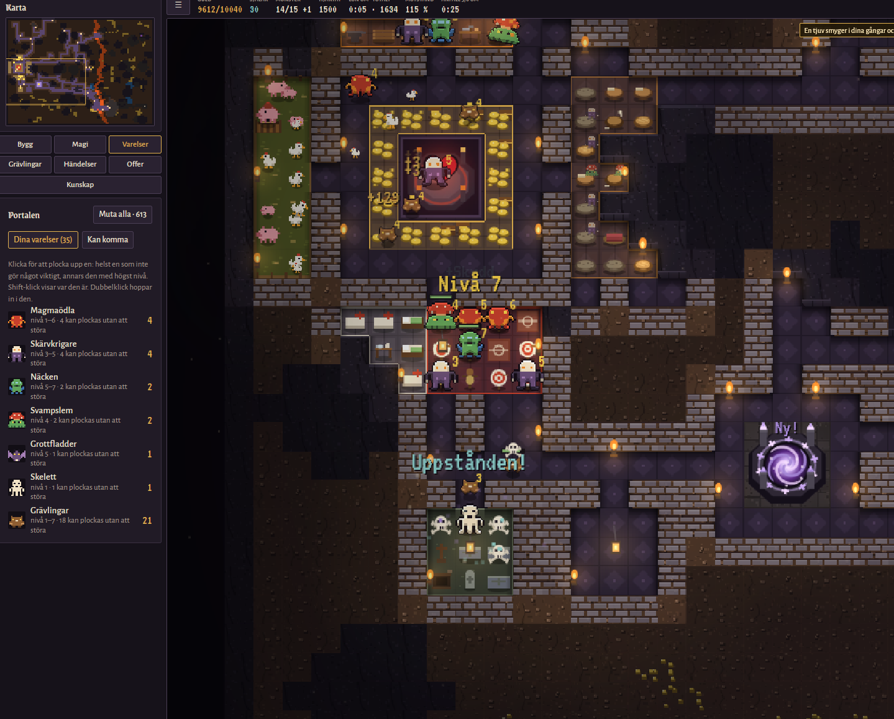
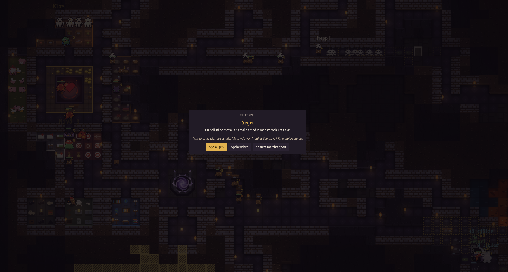
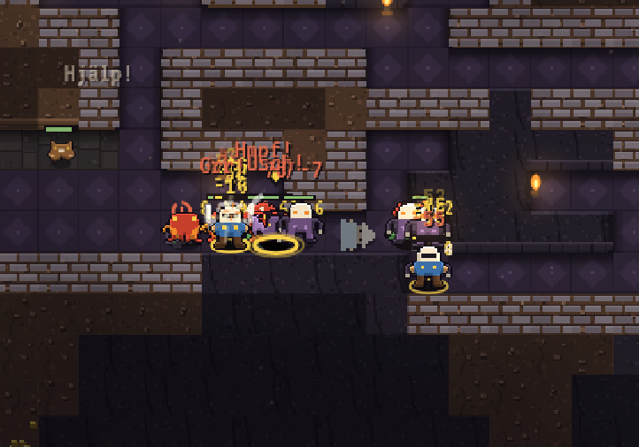
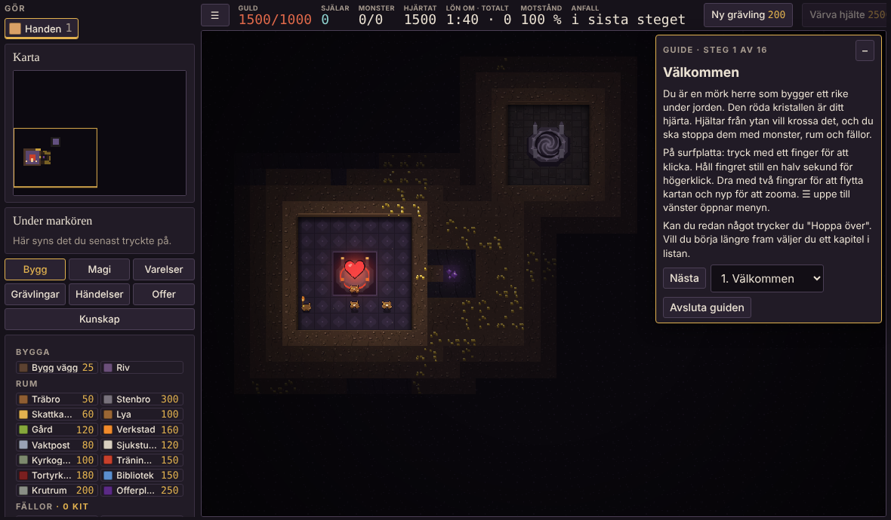
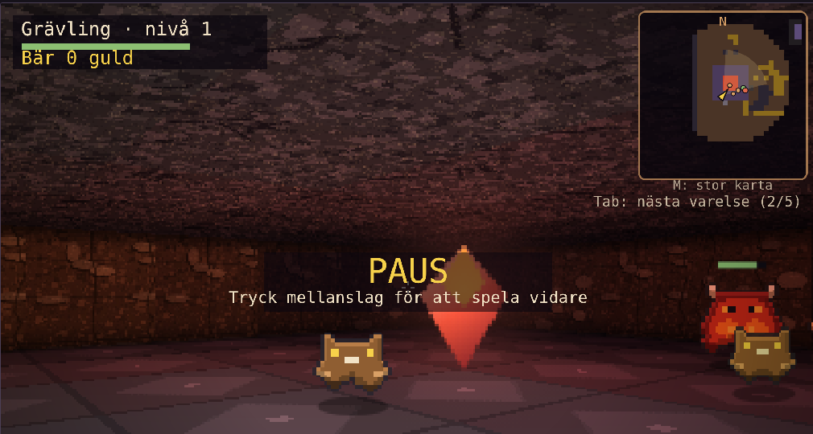

# Grottmästaren

Ett grottstrategispel på svenska, inspirerat av Dungeon Keeper. Gräv ut ditt rike, bryt guld, bygg rum, locka monster genom portalen och håll hjältarna borta från hjärtat.

*A Swedish dungeon-building strategy game inspired by Dungeon Keeper. English is available in the game's menu.*



Spelet är byggt med AI (Claude från Anthropic) under en vecka i oktober 2026, för att spelas hemma med barnen. Det är ett bidrag till SweClockers × ASUS-tävlingen "Gör det du länge velat, men inte kunnat. Med AI."

## Det här finns i spelet

- **Kampanj** med 16 nivåer, hjältar som anfaller och datorrivaler som bygger egna grottor.
- **Guide** för nya spelare, för både mus och pekskärm.
- **Monsterverkstad** där du ritar och skapar egna monster.
- **Baneditor** för egna banor med datorspelare, vaktande monster, hemliga rum och fällor.
- **Hoppa in** i ett monster och styr det själv, i 2D eller 3D.
- **Nätverksspel** för upp till fyra spelare i hemmanätet, med lägena Kungen av kullen, Sista hjärtat och Guldrush. Tomma platser fylls med datorspelare.
- Fungerar på dator, iPad, Android-platta och telefon. Svenska och engelska.

## Spela

**Enklast:** öppna `index.html` i Chrome, Edge, Firefox eller Safari.

**På iPad eller platta i hemmanätet (Windows):** dubbelklicka på `Starta Grottmastaren.bat`. Fönstret visar en adress som du öppnar i Safari eller Chrome på plattan. Se `LÄS MIG.txt`.

**Nätverksspel för fyra:** installera [Node.js](https://nodejs.org) och dubbelklicka på `Starta natverksspel.bat`, eller kör:

```
node server.js
```

Alla öppnar adressen som visas, väljer **Nätverk**, skriver sitt namn och trycker **Gå med**. Servern startar en osynlig Edge- eller Chrome-flik som kör spelet, så att plattorna bara behöver rita.

## Filer

| Fil | Vad den gör |
| --- | --- |
| `index.html` | Hela spelet i en fil |
| `server.js` | Nätverksservern (Node.js, inga extra paket) |
| `Starta natverksspel.bat` | Startar nätverksservern på Windows |
| `server.ps1` | Enkel webbserver för att spela på surfplatta |
| `Starta Grottmastaren.bat` | Startar den enkla servern på Windows |
| `LÄS MIG.txt` | Instruktioner för iPad och hemmanätet |

## Byggt med

- [Claude](https://claude.ai) (Anthropic) skrev koden utifrån mina idéer, krav och testspelande.
- [three.js](https://threejs.org) r128 (MIT-licens) för 3D-vyn, hämtas från cdnjs.
- [Google Fonts](https://fonts.google.com): Alegreya Sans, Grenze Gotisch och VT323 (SIL Open Font License).
- Testerna kördes med [Playwright](https://playwright.dev).

Grafiken är pixelfigurer som ritas i koden och ljudet syntetiseras i webbläsaren. Citaten i spelet kommer från fria källor, till exempel ordspråk, Bibeln 1917, Shakespeare och antika författare.

## Bilder

| | |
| --- | --- |
|  |  |
|  |  |

## Licens

MIT, se [LICENSE](LICENSE). Dungeon Keeper är ett varumärke som tillhör Electronic Arts. Grottmästaren har ingen koppling till EA.
